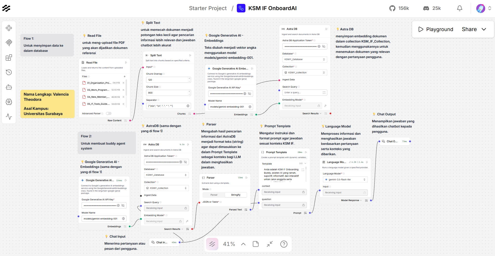
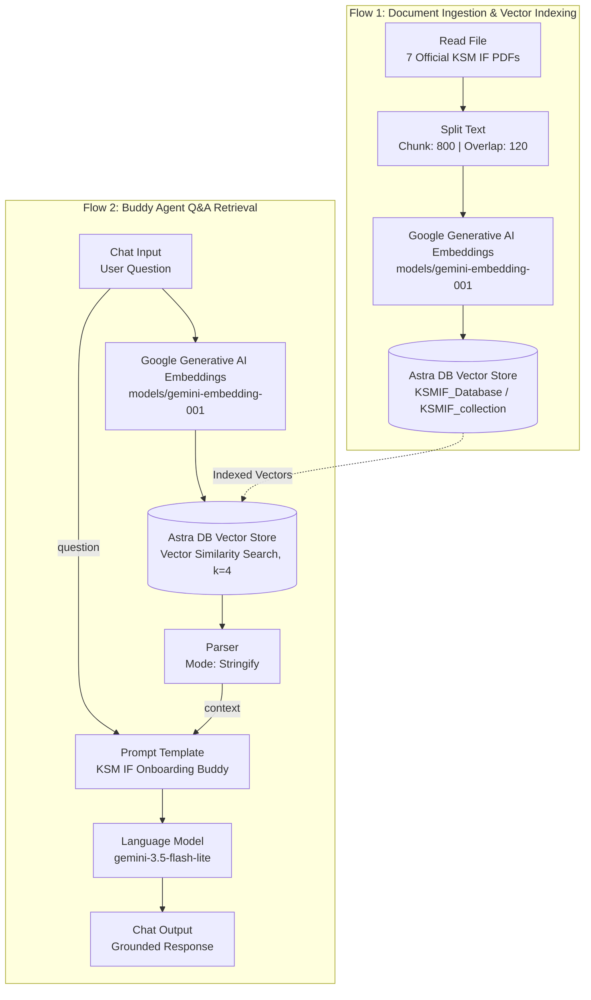

# ksm-if-onboardai-rag
AI-powered Retrieval-Augmented Generation (RAG) onboarding assistant for new members of Kelompok Studi Mahasiswa Informatika (KSM IF), Universitas Surabaya — built with Langflow, Google Gemini, and DataStax Astra DB.
# 🤖 KSM IF OnboardAI

**AI-Powered Intelligent Onboarding System for New Members of Kelompok Studi Mahasiswa Informatika (KSM IF) — Universitas Surabaya**

**KSM IF OnboardAI** is a Retrieval-Augmented Generation (RAG) conversational assistant built using **Langflow**, **Google Gemini**, and **DataStax Astra DB**. Designed as the **KSM IF Onboarding Buddy**, the system centralizes organizational knowledge and guides new members through KSM IF's culture, department structures, work programs (*program kerja*), digital tools, and onboarding Standard Operating Procedures (SOPs).

---

## 📋 Table of Contents
- [Problem Statement & Impact](#-problem-statement--impact)
- [Target Users](#-target-users)
- [Key Benefits](#-key-benefits)
- [System Architecture](#-system-architecture)
  - [Pipeline Overview](#pipeline-overview)
  - [Component & Hyperparameter Specifications](#component--hyperparameter-specifications)
- [Knowledge Base Structure](#-knowledge-base-structure)
- [Setup & Installation](#-setup--installation)
- [Playground Demo & Verification](#-playground-demo--verification)
- [Future Development Roadmap](#-future-development-roadmap)

---

## 🎯 Problem Statement & Impact

Onboarding new members into **KSM IF Universitas Surabaya** frequently faces bottlenecks because critical organizational information—ranging from management structures and division responsibilities to work programs, administrative SOPs, and digital tool guides—is scattered across separate documents, chat groups, and platforms.

### Affected Stakeholders
- **New Members (*Anggota Baru KSM IF*):** Experience difficulty understanding organizational culture, management structure, division tasks, and event execution workflows.
- **Committee & Senior Members (*Pengurus & Anggota Lama*):** Must repeatedly answer the same foundational questions and manually guide newcomers through basic organizational info.
- **Division Coordinators (*Koordinator Divisi*):** Spend additional time re-explaining internal workflows, task delegation, and operational standards to incoming members.

### Why It Matters
A structured, AI-assisted onboarding system enables new members to adapt faster, understand their roles clearly, and contribute effectively while maintaining consistent, verified answers across the organization.

---

## 👥 Target Users

| User Group | Role | Primary Needs |
| :--- | :--- | :--- |
| **1. New Members (*Anggota Baru KSM IF*)** | Primary Users | Easy-to-understand onboarding guides, centralized information access, and instant answers to organizational questions. |
| **2. Committee & Division Coordinators (*Pengurus & Koordinator Divisi*)** | Supporting Users | Reduced repetitive Q&A, standardized onboarding materials, and visibility into newcomer comprehension. |
| **3. Core Executive Board (*Pengurus Inti / BPH*)** | Administrative Users | Updating official documentation, managing access permissions, and keeping onboarding content up to date. |

---

## ✨ Key Benefits

- **Accelerates Newcomer Adaptation:** Enables self-paced learning of organizational structure, division duties, and operational workflows.
- **Centralizes Organizational Knowledge:** Unifies handbooks, SOPs, FAQs, IT tool guides, and work program schedules in one conversational interface.
- **Reduces Committee Workload:** Automates responses to repetitive onboarding questions so coordinators and vice-coordinators can focus on mentoring and program execution.
- **Ensures Information Consistency:** Grounds every response strictly in verified official KSM IF documentation.
- **Improves Member Engagement:** Supports structured onboarding stages, checklists, and interactive Q&A aligned with KSM IF's *"We Not Me"* motto.
- **Preserves Institutional Knowledge:** Retains centralized documentation for future leadership periods (*regenerasi kepengurusan*).

---

## 🏗️ System Architecture

The system is implemented in **Langflow (`v1.12.2`)** using a dual-pipeline RAG architecture backed by **DataStax Astra DB** and **Google Generative AI**.



### Pipeline Overview



### Component & Hyperparameter Specifications

| Flow | Component | Configuration / Model | Purpose |
| :--- | :--- | :--- | :--- |
| **Flow 1** | **Read File** | Standard PDF Parser (7 PDFs) | Extracts raw text from official KSM IF onboarding documents. |
| **Flow 1** | **Split Text** | `Chunk Size: 800`, `Overlap: 120`, Separators: `["\n\n", "\n", ". ", " ", ""]` | Splits documents into semantic chunks to optimize retrieval precision. |
| **Flow 1 & 2** | **Google Generative AI Embeddings** | `models/gemini-embedding-001` | Converts document chunks and user queries into dense vector embeddings. |
| **Flow 1 & 2** | **Astra DB** | DB: `KSMIF_Database`, Keyspace: `default_keyspace`, Collection: `KSMIF_collection`, `Vector Search` (`Similarity`, `top_k = 4`) | Stores document embeddings and retrieves the top 4 most relevant context chunks per query. |
| **Flow 2** | **Parser** | Mode: `Stringify` | Converts retrieved Astra DB JSON records into clean string context for prompt injection. |
| **Flow 2** | **Prompt Template** | Custom Persona & Guardrails (`{context}`, `{question}`) | Enforces strict grounding, prevents hallucination or cross-department confusion, and applies KSM IF's *"We Not Me"* tone. |
| **Flow 2** | **Language Model** | `gemini-3.5-flash-lite` (`Temperature: 0.1`, `Stream: False`) | Generates accurate, low-hallucination responses in Indonesian based on retrieved context. |

---

## 📚 Knowledge Base Structure

The vector database indexes **7 official KSM IF reference documents** mapped to specific topic routing rules inside the system prompt:

1. **`01_Organization_Profile.pdf`** — General profile, history, vision, mission, organizational identity, and the *"We Not Me"* slogan.
2. **`02_Department_Handbook.pdf`** — Organizational hierarchy and division responsibilities:
   - **BPH** (*Badan Pengurus Harian*): Leadership, administration, finance, and work program supervision.
   - **IRD** (*Internal Relations Department*): Internal bonding activities and member engagement.
   - **PRD** (*Public Relations Department*): External relations, comparative studies (*studi banding*), and inter-organizational collaboration.
   - **HRDD** (*Human Resource Development Department*): Soft/hard skill development, *Bursa Soal*, and the KSM IF website.
   - **CDD** (*Creative Design Department*): Visual identity, graphic design needs, and social media content.
3. **`03_Work_Programs.pdf`** — Work programs (*program kerja*), objectives, schedules, locations, and involved divisions.
4. **`04_New_Member_FAQ.pdf`** — Frequently asked questions for prospective and new members, registration details, and official information channels.
5. **`05_IT_Tools_Guide.pdf`** — Guide to KSM IF digital infrastructure (Website, WhatsApp Community, Google Spreadsheet, Google Drive, Instagram, GitHub, *Gallery Proker*, and *Bursa Soal*).
6. **`06_Onboarding_SOP.pdf`** — Step-by-step new member onboarding stages, department introductions, mandatory materials, and onboarding evaluations.
7. **`07_Member_Guidelines.pdf`** — Member code of conduct, internal communication etiquette, collaboration standards, documentation, and privacy policies.

---

## 🚀 Setup & Installation

### Prerequisites
- **Langflow** (`v1.12.2` or compatible) — self-hosted or DataStax Langflow Cloud
- **Google AI Studio API Key** (with access to `models/gemini-embedding-001` and `gemini-3.5-flash-lite`)
- **DataStax Astra DB Account** (with a Vector Database named `KSMIF_Database` and collection `KSMIF_collection`)

### Step-by-Step Deployment
1. **Clone this repository:**
   ```bash
   git clone [https://github.com/valenciatheodora07-tech/ksm-if-onboardai-rag.git](https://github.com/valenciatheodora07-tech/ksm-if-onboardai-rag.git)
   cd ksm-if-onboardai-rag
   ```
2. **Import the Langflow Pipeline:**
   - Open your Langflow workspace and click **Import** (or **New Project → Upload a Flow**).
   - Select `flows/KSM_IF_OnboardAI.json`.
3. **Configure Credentials:**
   - Enter your **Google Generative AI API Key** in both `Google Generative AI Embeddings` nodes (and configure your Google provider credentials in the `Language Model` node).
   - Enter your **Astra DB Application Token** (`AstraCS:...`) in both `Astra DB` nodes and verify that `Database` is set to `KSMIF_Database` and `Collection` is set to `KSMIF_collection`.
4. **Ingest Knowledge Base (Flow 1):**
   - Upload the 7 PDF documents from `knowledge-base/` into the **Read File** node.
   - Run the **Astra DB** ingestion node in **Flow 1** to chunk, embed, and store the vectors.
5. **Launch the Buddy Agent (Flow 2):**
   - Click **Playground** in the top-right corner of Langflow to start interacting with **KSM IF Onboarding Buddy**.

---

## 🧪 Playground Demo & Verification

The assistant was evaluated in the **Langflow Playground** across core newcomer onboarding scenarios (full session captures available in [`docs/Playground_Demo.pdf`](docs/Playground_Demo.pdf)):

| Test Scenario | User Prompt | Agent Behavior & Verified Output | Performance |
| :--- | :--- | :--- | :--- |
| **1. First-Time Onboarding Guidance** | *"Halo, aku anggota baru. Aku bingung harus mulai dari mana."* | Greets the member warmly with *"We Not Me"*, outlines Stage 1 Onboarding (reading Organization Profile, learning the 5 departments, attending intro sessions), and asks which department they joined. | `4.2K` tokens · `10.0s` |
| **2. Work Programs Inquiry** | *"Jelaskan mengenai program kerja yang ada di KSM IF."* | Accurately lists and details 6 official programs from the handbook: *Latihan Sidang Tugas Akhir (LSTA)*, *Studi Banding 2027*, *StudyClub 2027*, *Coding To Highschoolers (CTHS) 2026*, *Informatics Gathering 2027*, and *Studi Ekskursi 2027* with dates, venues, and divisions. | `4.7K` tokens · `20.0s` |
| **3. Organizational Culture** | *"Bagaimana lingkungan antar mahasiswa dalam KSM IF?"* | Explains KSM IF's collaborative peer environment, highlighting **IRD** (internal bonding), **HRDD** (member development), and the *"We Not Me"* philosophy. | `4.5K` tokens · `8.9s` |

---

## 🗺️ Future Development Roadmap

1. **Personalized Onboarding Path:** Role- and division-specific learning tracks tailored for members in `IRD`, `PRD`, `HRDD`, and `CDD`.
2. **AI Quiz & Learning Assessment:** Automated comprehension quizzes generated from official handbooks with explanations for incorrect answers to identify knowledge gaps.
3. **Onboarding Analytics Dashboard:** Admin dashboard tracking completion rates, quiz scores, top newcomer FAQs, and documentation areas needing revision.
4. **Organizational Platform Integration:** Direct integration with Google Drive, Google Calendar, and KSM IF communication platforms for live document sync and event reminders.
5. **Multimodal AI Assistant:** Native understanding of slide decks, visual posters, and voice-based conversational interactions.

---
